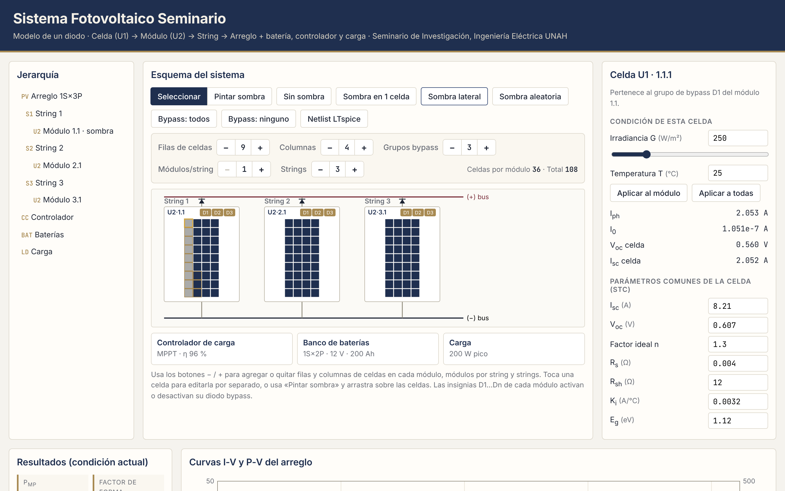
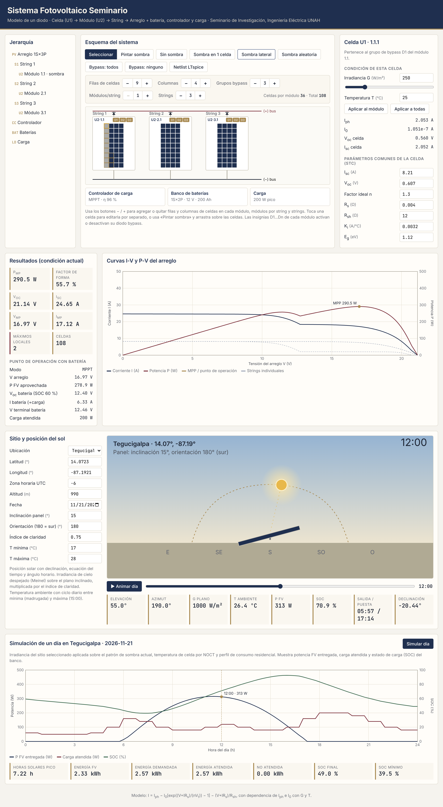

# Sistema Fotovoltaico Seminario

Simulador interactivo de un sistema fotovoltaico aislado, desde la celda hasta el arreglo completo con batería, controlador de carga y consumo. Hecho para el Seminario de Investigación de Ingeniería Eléctrica de la UNAH.

**▶ Abrir el simulador:** https://simuladorfotovoltaico.online/

*English version:* https://simuladorfotovoltaico.online/?lang=en · [Read in English](#english)

## Qué hace

- **Modelo de un diodo por celda**, con dependencia de la irradiancia (G) y la temperatura (T):
  I = Iph − I0[exp((V + I·Rs)/(n·Vt)) − 1] − (V + I·Rs)/Rsh
- **Jerarquía completa:** celda (U1) → módulo (U2) → string → arreglo. Puedes agregar o quitar filas y columnas de celdas, grupos de bypass, módulos por string y strings con los botones − / +.
- **Sombras parciales:** cada celda tiene su propia irradiancia y temperatura. Puedes pintar sombra con el ratón o usar los ajustes rápidos (una celda, lateral, aleatoria).
- **Diodos bypass y de bloqueo:** se activan o desactivan por grupo para ver cómo aparecen varios máximos locales en la curva P‑V.
- **Curvas I‑V y P‑V** del arreglo y de cada string, con el punto de máxima potencia (MPP).
- **Batería y controlador:** banco plomo‑ácido configurable, controlador MPPT o de acople directo (PWM), con corte por carga completa y desconexión por bajo voltaje (LVD).
- **Posición del sol y simulación de un día:** irradiancia de cielo despejado sobre el panel inclinado para ciudades de Honduras o un sitio personalizado, con potencia FV, consumo y estado de carga (SOC) cada 15 minutos.
- **Exportar a LTspice:** genera el netlist del arreglo con un subcircuito por celda.

## Cómo usarlo

No necesita instalación. Abre el enlace de arriba o descarga `index.html` y ábrelo en el navegador.

1. Elige un elemento en **Jerarquía** o toca una celda del esquema para editar sus parámetros en el panel derecho.
2. Usa **Pintar sombra** y arrastra sobre las celdas para simular sombras.
3. Mira cómo cambian los resultados, las curvas y el punto de operación con la batería.
4. En **Sitio y posición del sol**, elige ubicación y fecha, y pulsa **Simular día**.
5. Usa el botón **ES / EN** (arriba a la derecha) para cambiar el idioma.

## English

Interactive simulator of a stand-alone photovoltaic system, from a single cell up to the full array with battery, charge controller and load. Built for the Research Seminar of Electrical Engineering at UNAH (Honduras).

**▶ Open the simulator:** https://simuladorfotovoltaico.online/?lang=en

- **Single-diode cell model** with irradiance and temperature dependence.
- **Full hierarchy:** cell → module → string → array; add or remove cell rows/columns, bypass groups, modules and strings.
- **Partial shading** per cell, with **bypass and blocking diodes**, showing multiple local maxima on the P‑V curve.
- **I‑V and P‑V curves**, MPP, and the **battery / MPPT or PWM controller** operating point.
- **Sun position and one-day simulation** for cities in Honduras or a custom site.
- **LTspice netlist export.**

No installation needed: open the link or download `index.html`. Use the **ES / EN** button in the top-right corner to switch languages.

## Autores

- Claudia Figueroa
- Dennis Johan López
- M.Sc. Daniel Flores

## Licencia

[MIT](LICENSE)
