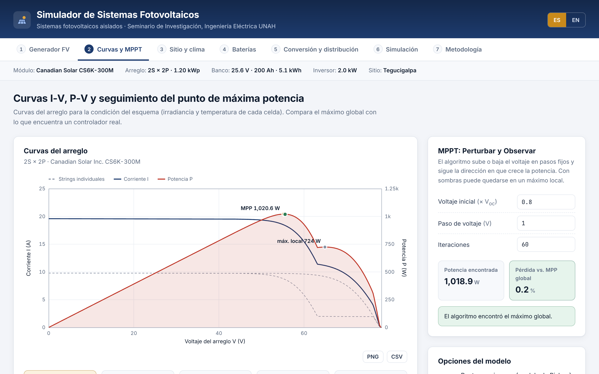
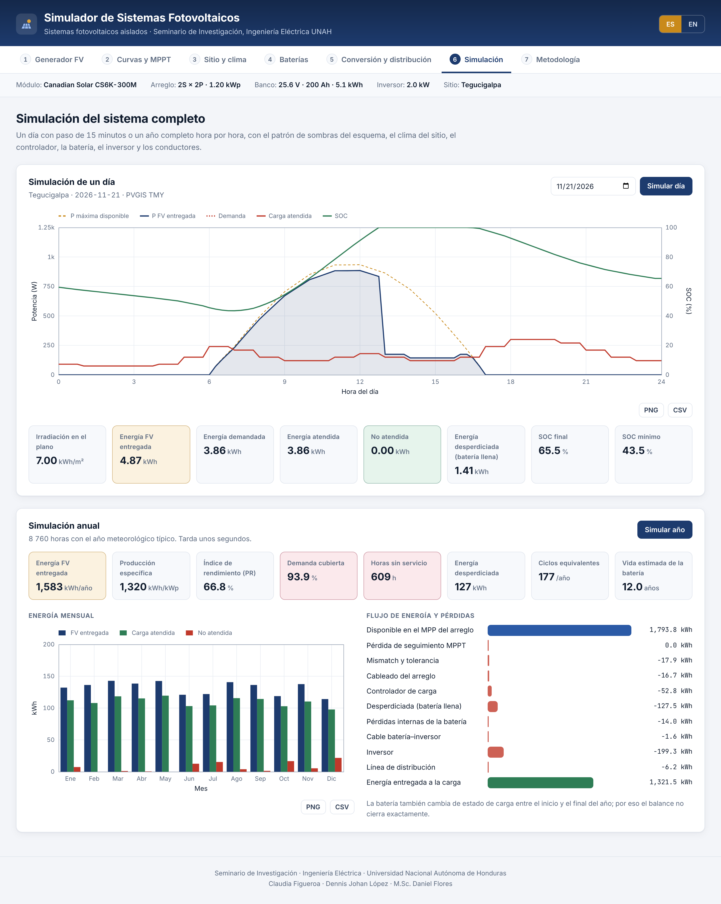

# Sistema Fotovoltaico Seminario

Simulador interactivo de un sistema fotovoltaico aislado, desde la celda hasta el arreglo completo con batería, controlador de carga y consumo. Hecho para el Seminario de Investigación de Ingeniería Eléctrica de la UNAH.

**▶ Abrir el simulador:** https://simuladorfotovoltaico.online/

*English version:* https://simuladorfotovoltaico.online/?lang=en · [Read in English](#english)

## Qué hace

**Generador fotovoltaico**
- **Módulos comerciales reales** (Kyocera, Renogy, Canadian Solar, LONGi, Trina) con datos de hoja técnica de la base de datos CEC, o un módulo personalizado.
- **Ajuste automático de parámetros** (Rs, Rsh, n) a partir de la hoja técnica (método de Villalva) y **validación**: error menor a 0,4 % en Pmax, Vmp, Imp, Voc e Isc.
- **Modelo de un diodo con ruptura en inversa de Bishop**: muestra el voltaje inverso y la potencia que disipa una celda sombreada (punto caliente).
- Arreglo en serie y paralelo, **sombras celda por celda**, diodos bypass Schottky y diodo de bloqueo.

**Curvas y MPPT**
- Curvas I‑V y P‑V con todos los máximos locales.
- **Algoritmo Perturbar y Observar** paso a paso: muestra cuándo se queda atrapado en un máximo local y cuánta energía se pierde.

**Sitio y clima**
- **Datos meteorológicos reales** (año meteorológico típico de PVGIS, hora por hora) para Tegucigalpa, San Pedro Sula, Choluteca, La Ceiba y Santa Rosa de Copán.
- Transposición al plano inclinado (Hay–Davies), pérdidas por ángulo de incidencia, suciedad, mismatch y degradación; temperatura de celda con viento (Faiman).

**Baterías, conversión y distribución**
- Catálogo de baterías (plomo‑ácido, AGM, gel, LiFePO₄) con modelo de Shepherd, ley de Peukert, eficiencia y vida en ciclos.
- Controlador MPPT o PWM, inversores con curva de eficiencia, y **conductores y línea de distribución** con caída de tensión, pérdidas y ampacidad (NEC).

**Simulación**
- Un día cada 15 minutos o **un año completo hora por hora**: energía producida, demanda cubierta, horas sin servicio, índice de rendimiento (PR), ciclos y vida estimada de la batería, y **flujo de energía con todas las pérdidas**.
- Todos los gráficos se descargan en **PNG de alta resolución** y **CSV** para usarlos en informes.

## Cómo usarlo

No necesita instalación: abre el enlace de arriba. Para usarlo sin internet, descarga el repositorio completo y abre `index.html`.

1. **Generador FV**: elige el módulo, arma el arreglo y aplica sombras.
2. **Curvas y MPPT**: revisa los máximos, el algoritmo P&O y los puntos calientes.
3. **Sitio y clima**: elige la ciudad, la inclinación y las pérdidas.
4. **Baterías** y **Conversión y distribución**: configura el resto del sistema.
5. **Simulación**: simula un día o un año completo.
6. Usa el botón **ES / EN** (arriba a la derecha) para cambiar el idioma.

## English

Interactive simulator of a stand-alone photovoltaic system, from a single cell up to the full array with battery, charge controller and load. Built for the Research Seminar of Electrical Engineering at UNAH (Honduras).

**▶ Open the simulator:** https://simuladorfotovoltaico.online/?lang=en

- **Real commercial modules** (CEC database) with automatic parameter fitting (Villalva method) and **validation against the datasheet** (error below 0.4 %).
- **Single-diode model with Bishop reverse breakdown**: hot-spot power of shaded cells, Schottky bypass and blocking diodes.
- **Perturb and Observe MPPT** that can get trapped on a local maximum under partial shading.
- **Real hourly weather data** (PVGIS typical meteorological year) for five cities in Honduras; Hay–Davies transposition, incidence-angle, soiling, mismatch and degradation losses; Faiman cell temperature.
- **Battery catalog** (lead-acid, AGM, gel, LiFePO₄) with Shepherd model, Peukert law and cycle life; inverters with efficiency curve; **conductors and distribution line** with voltage drop, losses and ampacity.
- **Daily and full-year hourly simulation** with energy-flow and loss breakdown. Every chart exports to high-resolution PNG and CSV.

No installation needed: open the link. To use it offline, download the whole repository and open `index.html`. Use the **ES / EN** button in the top-right corner to switch languages.

## Autores

- Claudia Figueroa
- Dennis Johan López
- M.Sc. Daniel Flores

## Licencia

[MIT](LICENSE)
